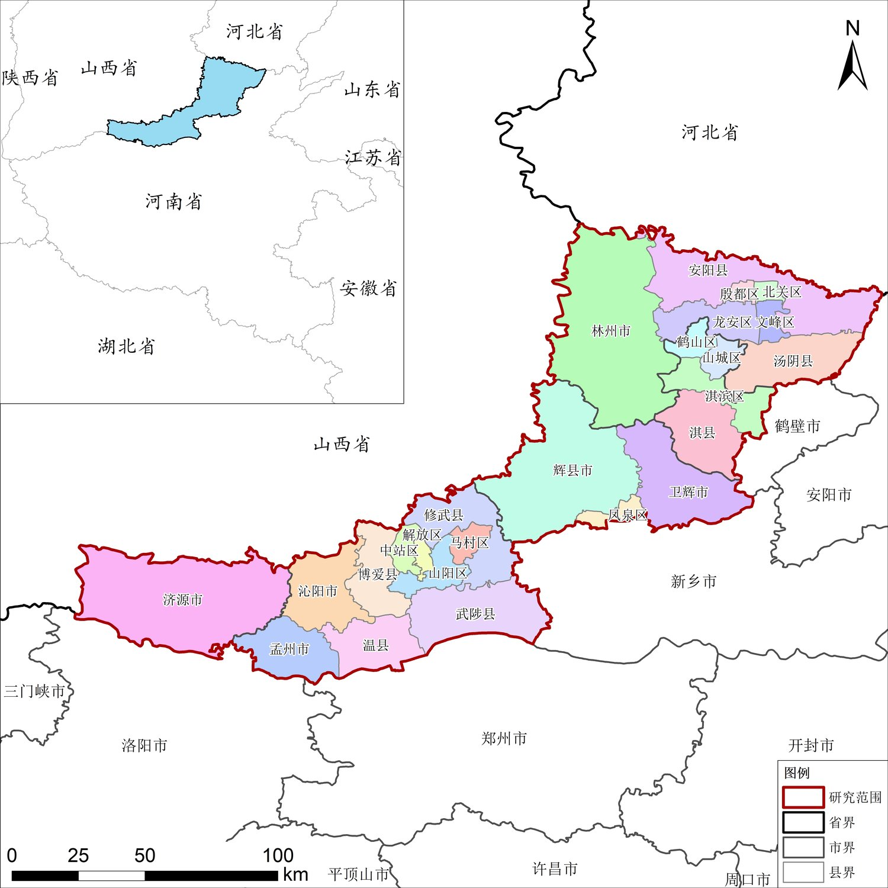
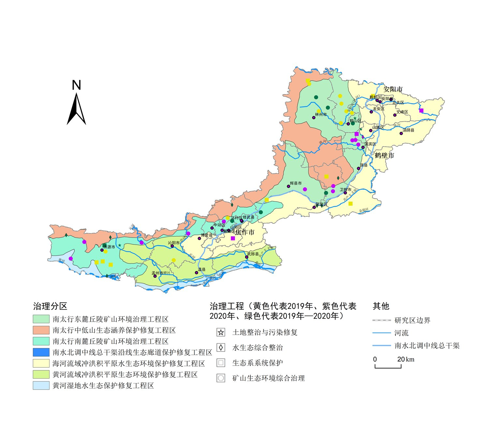
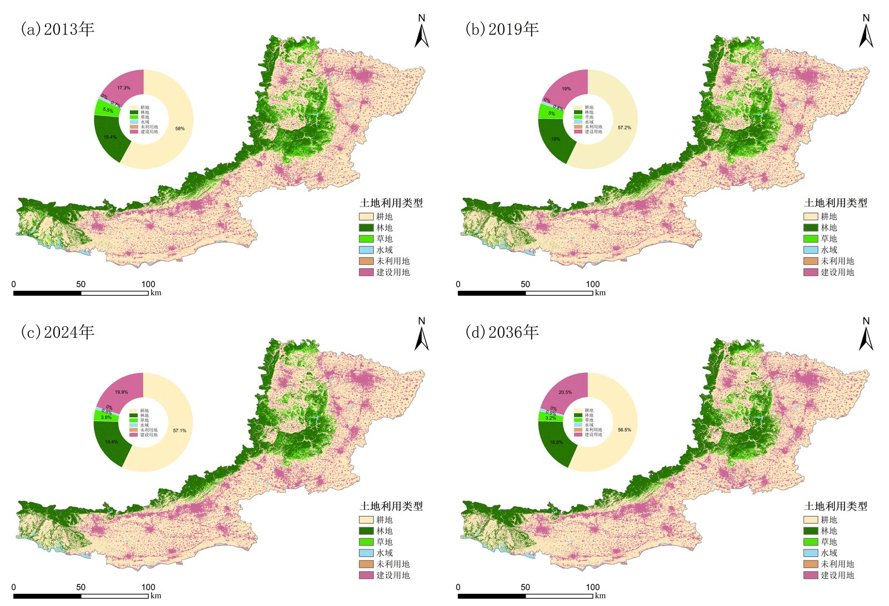
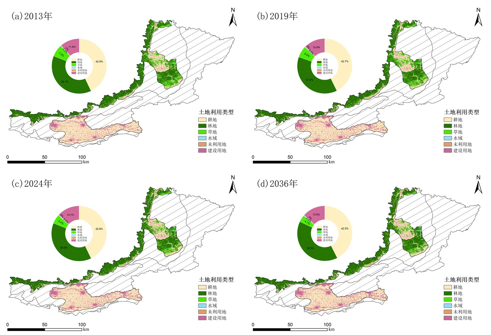
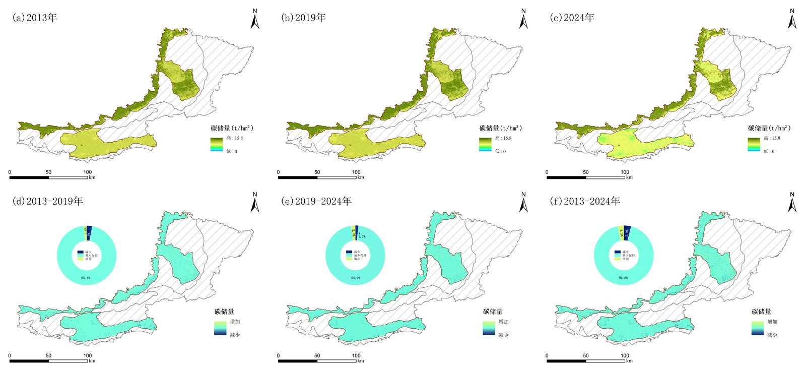
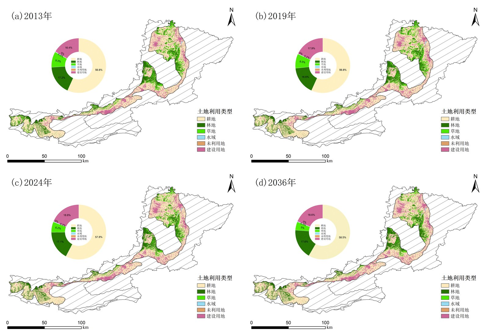

# 01 · 南太行生态修复成效评估

> 竞赛项目：全国大学生国土空间规划技能大赛（国地杯）参赛作品
> 研究区：南太行地区，按功能划分为 **矿山治理区 / 生态涵养区 / 水生态保护区** 三类分区
> 我的工作：空间统计与指标权重、生态系统服务评估、成果制图

## 项目做了什么

南太行地区长期采矿造成生态受损，需要回答「修复工程到底有没有效果、哪些区域值得优先投」。整体思路是：**把研究区切成渔网格网 → 逐网格算生态指标 → 赋权重合成综合指数 → 分功能区对比**。

我的部分集中在三块：

1. **空间统计与权重体系**（`scripts/`）：用 ArcPy 建渔网、把矢量要素按格网统计、计算各指标权重、导出属性表格
2. **生态系统服务评估**（`analysis/`）：用 InVEST 模型分别算 PM2.5 净化、土壤保持、生境质量三类服务
3. **成果制图**（`figures/`）：批量导出成图、统一命名、柱状对比图

## 目录与脚本

```
01-nantaihang-restoration/
├── scripts/      ArcPy 空间统计与权重计算（15 个脚本，按顺序编号）
├── weights/      指标权重计算 Notebook
├── analysis/     InVEST 三类服务评估 Notebook
└── figures/      成果图（6 张）+ 出图脚本
```

### scripts/ —— 按执行顺序编号

文件名前的数字只表示阅读顺序（数据准备 → 加权 → 汇总 → 整理），不是必须依次运行。

| # | 脚本 | 作用 | 输入 → 输出 |
|---|---|---|---|
| 01 | `01_渔网写入栅格统计值.py` | 把栅格指标按 2013 / 2019 / 2024 三期做分区统计，写进渔网（网格）属性字段 | 渔网 shp + 指标栅格 → 带 `m2013`/`m2019`/`m2024` 字段的渔网 |
| 02 | `02_按指标权重加权.py` | 按指标权重表（植被覆盖率 0.138、碳储量 0.258…）对栅格加权 | 指标栅格 + 权重表 → 加权栅格 |
| 03 | `03_按权重反算原始值.py` | 把已加权的像元值除以权重，反算出原始指标值（校验用） | 加权栅格 → 还原栅格 |
| 04 | `04_矢量按属性分类.py` | 矢量要素按属性值分级，生成分类字段 | 要素 shp → 带分类字段的 shp |
| 05 | `05_矢量图层赋权重.py` | 给矢量要素打上对应指标的权重 | 分类 shp → 带权重字段的 shp |
| 06 | `06_生成可视化矢量副本.py` | 生成只用于出图的可视化副本，避免污染原始数据 | 成果 shp → `可视化/` 目录副本 |
| 07 | `07_计算功能区总权重.py` | 按功能区（矿山治理 / 生态涵养 / 水生态保护）合成总权重 | 各指标权重 → 功能区总权重栅格 |
| 08 | `08_渔网图层总权重汇总.py` | 把总权重汇总到渔网图层，得到格网级综合得分 | 总权重栅格 + 渔网 → 格网得分表 |
| 09 | `09_特殊矢量指标汇总表_简版.py` | 汇总「地面沉降率」「适生林地占比」两个特殊矢量指标（第一版） | 渔网结果 shp → 指标表 |
| 10 | `10_特殊矢量指标汇总表.py` | 同上的完善版，补了批量遍历与异常处理 | 渔网结果 shp → 指标表 |
| 11 | `11_特殊矢量指标汇总表_多线程版.py` | 同上的多线程版本（`ThreadPoolExecutor`），指标多时明显更快 | 渔网结果 shp → 指标表 |
| 12 | `12_各功能区统计描述.py` | 计算各功能区指标的中位数、标准差等统计量 | 指标表 → 统计表 |
| 13 | `13_矿洞面积占比统计.py` | 统计各年份矿洞面积占矿山治理区总面积的比例 | 矿洞矢量 + 治理区边界 → Excel |
| 14 | `14_批量合并成果.py` | 把分散在各文件夹的成果批量合并 | 多目录成果 → 合并成果 |
| 15 | `15_批量按规范重命名.py` | 按命名规范批量改名（成果归档用） | 任意成果 → 规范命名 |

> 09 / 10 / 11 是同一功能的三个迭代版本，保留全部是为了看出优化过程（单线程 → 加异常处理 → 多线程），不是重复文件。

### analysis/

| Notebook | 内容 |
|---|---|
| `【PM2.5版】南太行生态修复分析.ipynb` | PM2.5 净化服务：生境质量与污染物去除量核算 |
| `【土壤保持版】南太行生态修复分析.ipynb` | 土壤保持服务：RUSLE 框架下的潜在与现实侵蚀量 |
| `【生境质量版】南太行生态修复分析.ipynb` | 生境质量：威胁因子、敏感度参数设置与 Habitat Quality 模块 |
| `参数调试.ipynb` | 分析过程中的中间试验与参数调试 |

三个版本结构一致：读取 InVEST 输出栅格 → 按功能区/格网统计 → 导出指标表 → 绘图对比。改 `版本` 和参数即可切换到另一类服务。

### weights/ 与 figures/

| 文件 | 作用 |
|---|---|
| `weights/指标权重计算.ipynb` | 指标权重的计算过程（ArcPy 环境） |
| `figures/批量导出统一DPI.py` | 批量按统一 dpi 导出成图，保证投稿分辨率 |
| `figures/批量图件命名_1.py`、`_2.py` | 批量按规范重命名图件（两个版本） |
| `figures/柱状图命名.py` | 柱状对比图的命名与导出 |

## 成果图

以下为竞赛方案书中的成图（已压缩至适合网页浏览的尺寸，原图分辨率更高）：

| 图 | 内容 |
|---|---|
|  | **研究区区位**：南太行山区在河南省及周边省的位置关系，含省市县三级边界 |
|  | **治理分区与工程布局**：6 类治理分区 + 4 类治理工程的点位分布（黄/紫色点区分 2019 与 2020 年工程） |
|  | **土地利用演变**：2013–2036 年多期对比，含未来情景模拟 |
|  | **生态系统服务演变**：综合服务能力的多期空间格局变化 |
|  | **碳储量演变**：多期碳储量估算对比 |
|  | **矿山生态修复演变**：修复前后对比，用于说明工程成效 |

> 图片由 `figures/` 下的脚本批量导出（`批量导出统一DPI.py` 统一分辨率，`批量图件命名_*.py` 规范命名）。

## 运行环境

- **ArcGIS Pro 3.x 自带的 Python 3.11**（`arcpy` 无法通过 pip 安装）
- 需要 **Spatial Analyst** 许可
- InVEST 模型建议用 [InVEST 官方安装包](https://naturalcapitalproject.stanford.edu/software/invest) 单独跑，本仓库的 Notebook 主要承担参数组织与结果后处理

```python
# 脚本开头通常是这样，改这里的路径即可
base_dir = r"dasai\南太行数据"
functional_areas = ["矿山治理区", "生态涵养区", "水生态保护区"]
```

## 数据说明

原始数据（DEM、土地利用、气象、NDVI、矿山分布矢量、功能区划矢量）体积约 7 GB，含项目方提供的数据，**未纳入仓库**。如需复现，需自行准备：

| 数据 | 要求 |
|---|---|
| DEM | 30 m 分辨率，覆盖研究区 |
| 土地利用 | 30 m，与 DEM 同投影 |
| 气象 | 降水、蒸散、风速年均值栅格 |
| 矢量 | 三类功能区边界、矿山治理图斑 |

注意：脚本按研究区所在投影带处理（高斯-克吕格），换研究区时需要重新设定投影与栅格对齐方式。

## 结果产出

- 各功能区三类生态系统服务的**格网级指标表**（`10_特殊矢量指标汇总表.py` 系列导出）
- 综合权重分布栅格与分功能区统计（中位数、标准差）
- 修复成效对比柱状图

> 具体数值因项目方数据保密要求未在此列出，如需可单独沟通。

## 备注

- `01_渔网写入栅格统计值.py` 与 `13_矿洞面积占比统计.py` 原本是同一个文件里两段交叉粘贴的代码（后半段缺少外层循环定义、无法运行），整理时按功能拆成两个独立脚本，代码逻辑未改动
- 脚本最初是在 ArcGIS Pro 的 Notebook 里边写边跑，因此有些逻辑分散在多个文件里（如权重被拆成 `02_按指标权重加权.py` / `07_计算功能区总权重.py` / `03_按权重反算原始值.py`），保留原样便于对照当时成果
- 三个生态系统服务版本结构高度相似，说明参数组织方式一致，只是模型输入与指标含义不同
