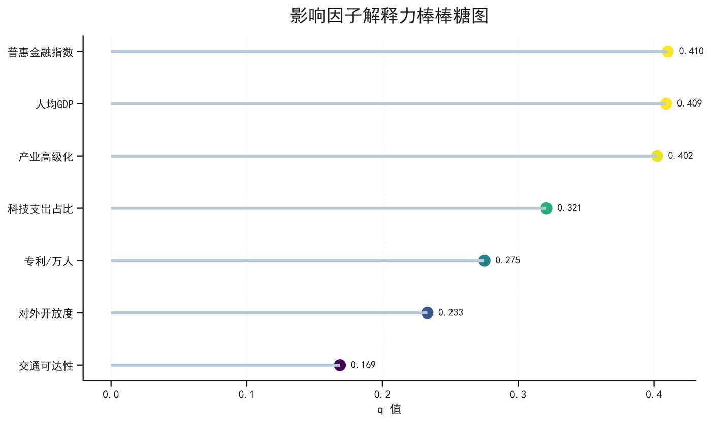
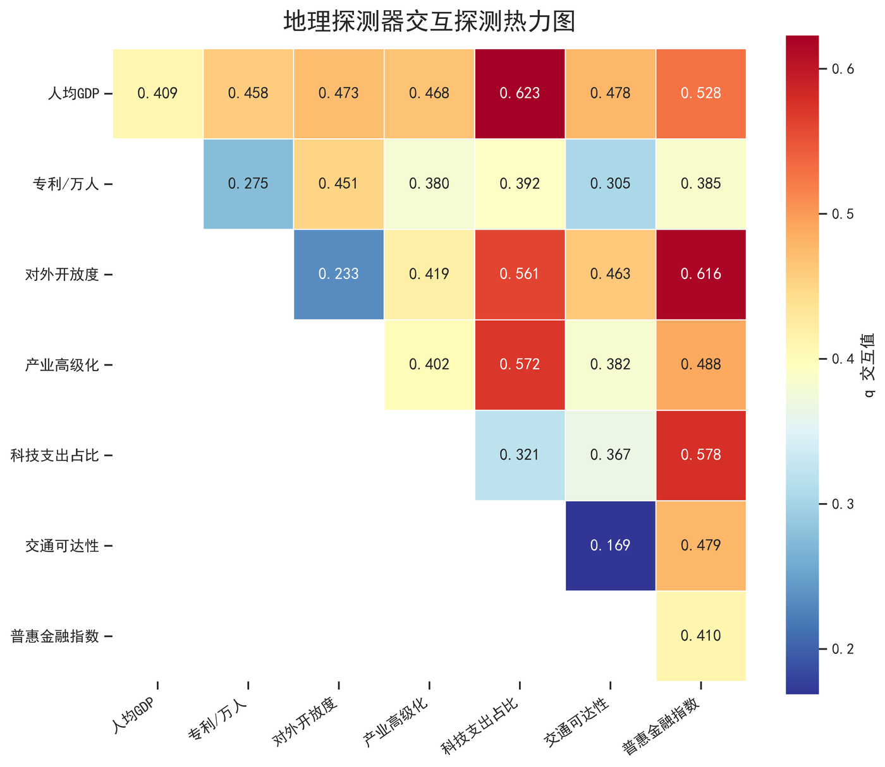
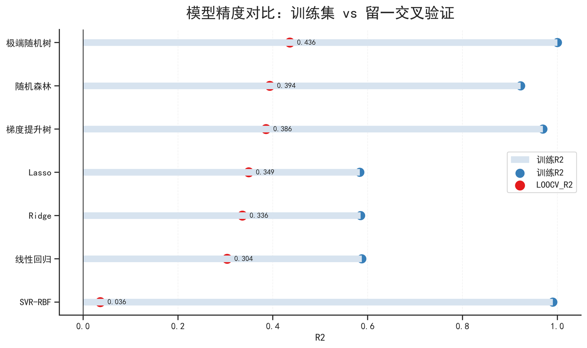
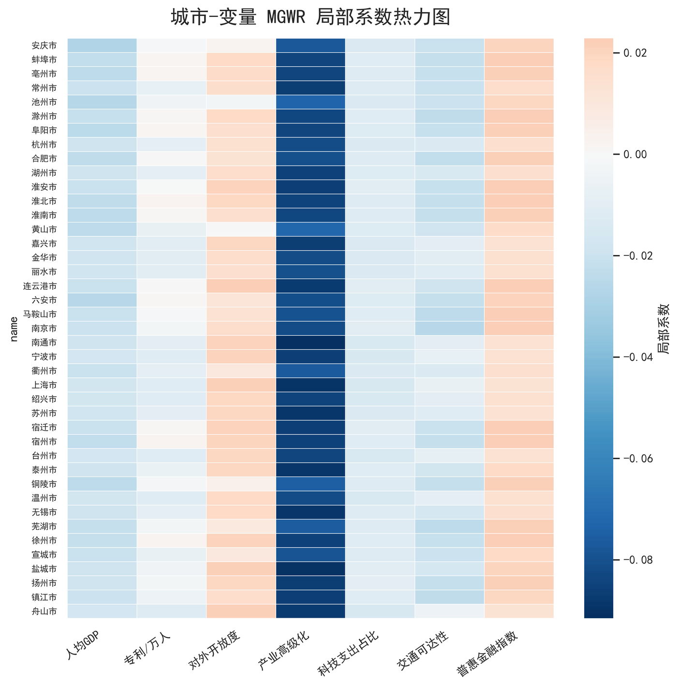
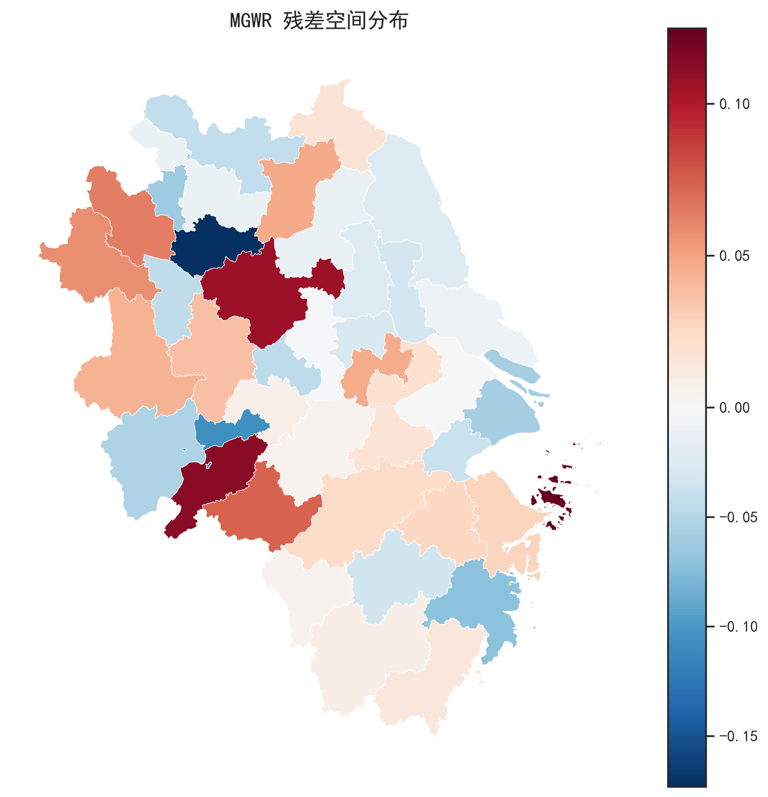
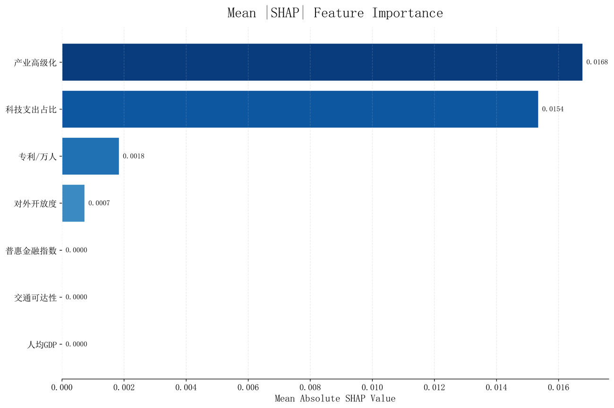
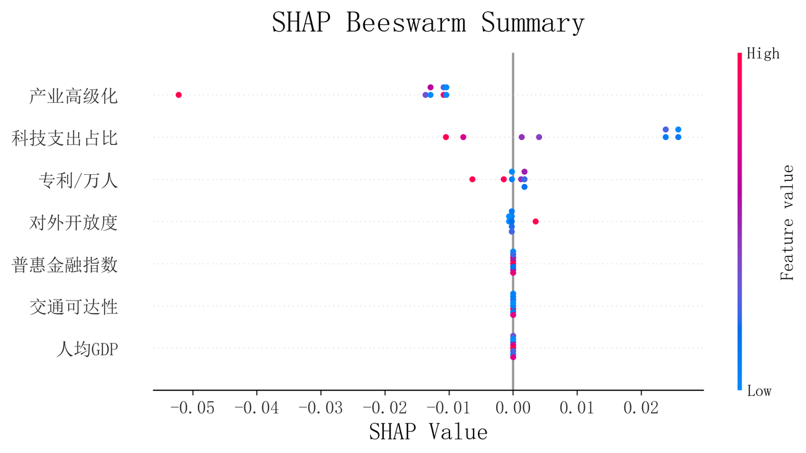
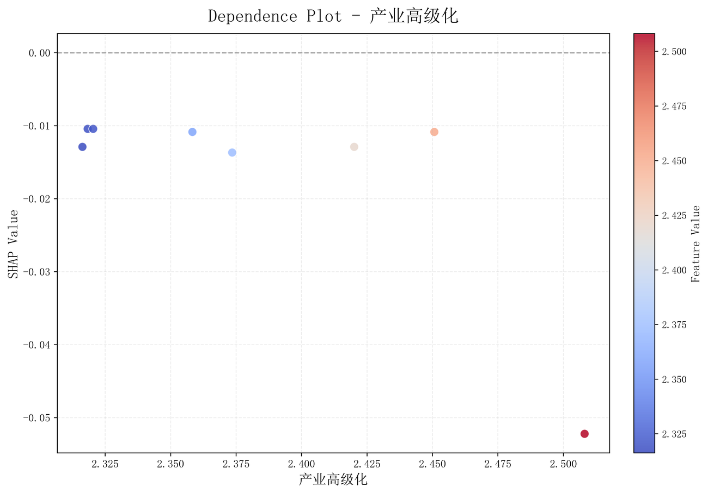

# 04 · 城市群发展空间异质性建模（MGWR + 地理探测器 + SHAP）

> 研究区：长三角城市群
> 目标变量：`XHM`（脚本中以列名引用，可在 `TARGET_COL` 处替换）
> 技术栈：MGWR、地理探测器、scikit-learn、XGBoost、SHAP、GeoPandas、Matplotlib

这是一个完整的空间异质性分析链路——不是只跑一个模型，而是**先证明「存在空间非平稳性」，再用局部模型刻画它，最后用机器学习和可解释性方法交叉验证**。

## 分析框架

```
① 全局基准         OLS / Lasso / Ridge / 线性回归
       ↓ 残差存在空间自相关 → 全局模型不够
② 空间局部化       MGWR（多尺度地理加权回归，逐变量带宽）
                   LISA 局部空间自相关（识别高-高、高-低聚集）
       ↓ 哪些因子重要？会不会交互？
③ 因子探测         地理探测器（q 值 + 交互探测矩阵）
       ↓ 非线性、交互效应怎么解释？
④ 机器学习 + 可解释性
                   XGBoost / 随机森林 / 极端随机树 / 梯度提升树 / SVR
                   7 个模型 LOOCV 交叉验证对比 → SHAP 归因
```

## 结果：7 个模型对比（留一交叉验证）

`mgwr/模型精度对比.csv` 实测输出：

| 模型 | 训练 R² | LOOCV R² | LOOCV RMSE | LOOCV MAE |
|---|---|---|---|---|
| **极端随机树** | 1.000 | **0.436** | **0.0727** | **0.0541** |
| 随机森林 | 0.922 | 0.394 | 0.0754 | 0.0575 |
| 梯度提升树 | 0.969 | 0.386 | 0.0758 | 0.0592 |
| Lasso | 0.583 | 0.349 | 0.0780 | 0.0572 |
| Ridge | 0.585 | 0.336 | 0.0788 | 0.0578 |
| 线性回归 | 0.588 | 0.304 | 0.0808 | 0.0592 |
| SVR-RBF | 0.990 | 0.036 | 0.0950 | 0.0690 |

两个值得注意的地方：

- **SVR-RBF 是典型过拟合**：训练 R² 高达 0.99，留一验证只剩 0.036，比线性回归还差。小样本空间数据上核方法极易过拟合。
- **树模型全面优于线性模型**（LOOCV R² 0.44 vs 0.30），说明因子与目标之间存在明显非线性与交互作用——这也正是后面用地理探测器和 SHAP 的理由。

## 结果：地理探测器因子解释力

`mgwr/地理探测器q值.csv`：

| 排名 | 因子 | q 值 |
|---|---|---|
| 1 | 普惠金融指数 | 0.410 |
| 2 | 人均 GDP | 0.409 |
| 3 | 产业高级化 | 0.402 |
| 4 | 科技支出占比 | 0.321 |
| 5 | 专利 / 万人 | 0.275 |
| 6 | 对外开放度 | 0.233 |
| 7 | 交通可达性 | 0.169 |

前三个因子 q 值几乎并列（0.40~0.41），说明**金融、经济总量、产业结构是同一层级的驱动因素**，单独强调任何一个都不成立。交通可达性解释力最低，与「长三角基础设施已高度均质化」的判断一致。

另附 `交互探测矩阵.csv` / `交互探测排序.csv`，用于判断因子两两之间是双因子增强还是非线性增强。

## 结果：LISA 局部空间聚类

`mgwr/LISA空间聚类.csv` 给出每个城市的局部 Moran's I 类型与显著性。例如舟山为 `HL 异常高值`（p=0.001）——自身水平高但被低值区包围，属于典型的「孤岛型」城市；多数城市不显著，说明长三角内部并非普遍存在强空间聚集，而是**局部极化**。

## 结果：SHAP 可解释性

`shap/model_test_metrics.csv`：

| 指标 | 值 |
|---|---|
| 测试集 R² | 0.169 |
| 测试集 RMSE | 0.0629 |
| 验证集 R² | 0.510 |
| 验证集 RMSE | 0.0466 |

`model_candidate_results.csv` 记录了超参数搜索过程（n_estimators、learning_rate、max_depth、正则项等），按验证集 RMSE 自动选优——避免手调参数带来的乐观偏差。

## 结果：图表

脚本自动输出的图（已压缩，原图在 `mgwr/output/` 与 `shap/` 下）：

| 图 | 内容 |
|---|---|
|  | 7 个因子的地理探测器 q 值排序：普惠金融 0.410、人均GDP 0.409、产业高级化 0.402 三者并列 |
|  | 因子两两交互探测矩阵，区分双因子增强与非线性增强 |
|  | 7 个模型的训练 R² 与 LOOCV R² 对比，直观暴露 SVR-RBF 的过拟合 |
|  | 各城市各变量的 MGWR 局部系数热力图，展示空间非平稳性 |
|  | MGWR 残差空间分布，检验模型是否已消除空间自相关 |
|  | SHAP 特征重要性排序，与地理探测器 q 值互为印证 |
|  | SHAP 蜂群图：因子取值高低对目标变量的正负向影响 |
|  | 核心特征的 SHAP 依赖关系，呈现非线性响应曲线 |

> 小瑕疵：`模型精度对比` 图例里「训练R²」出现两次（浅色条与蓝点各一个），是原脚本 `plt.legend` 传参重复所致，不影响读图，保留原样未改。

## 目录与脚本

```
04-mgwr-shap/
├── mgwr/
│   ├── MGWR.py                     主脚本：MGWR + 地理探测器 + 多模型精度对比 + 出图
│   ├── data.csv                    建模数据（城市尺度，含经纬度与 7 个因子）
│   ├── 模型精度对比.csv
│   ├── 地理探测器q值.csv
│   ├── 交互探测矩阵.csv / 交互探测排序.csv
│   ├── LISA空间聚类.csv
│   └── 城市预测残差与局部系数.csv
└── shap/
    ├── shap.py                     XGBoost + SHAP 归因
    ├── xgbosst.csv                 建模数据
    ├── model_candidate_results.csv
    └── model_test_metrics.csv
```

`MGWR.py` 文件头直接写明输出四类内容：模型精度/带宽/残差/局部系数表、地理探测器 q 值与交互矩阵、非地图型论文图表（q 值图、交互热力图、精度对比图、拟合图、残差图）、以及自动模型选优。

## 运行环境

```bash
pip install mgwr geopandas libpysal esda scikit-learn xgboost shap matplotlib pandas numpy
```

MGWR 依赖 `libpysal` 与 `spglm`，建议单独建环境（本机原环境在 `区域规划/MGWR/.conda`，未纳入仓库）。

## 数据说明

`data.csv` 已包含在仓库中（城市级，约 5 KB，字段为经纬度 + 7 个社会经济因子 + 目标变量），可直接跑通脚本。原始统计年鉴数据与空间权重矩阵需自备。

字段对照：

| 字段 | 含义 |
|---|---|
| `lon` / `lat` | 城市中心点经纬度 |
| `Feat1` | 人均 GDP |
| `Feat2` | 专利 / 万人 |
| `Feat3` | 对外开放度 |
| `Feat4` | 产业高级化 |
| `Feat5` | 科技支出占比 |
| `Feat6` | 交通可达性 |
| `Feat7` | 普惠金融指数 |
| `XHM` | 目标变量（因变量） |

## 这个项目的方法价值

1. **不迷信单一模型**：同时给全局回归、空间局部模型、树模型、核方法的结果，用 LOOCV 而不是训练集精度做判断
2. **有显著性检验**：LISA 带 p 值，地理探测器带 q 值，不是「画个图就下结论」
3. **有可解释性**：SHAP 弥补了树模型的黑箱问题，且做了超参数自动搜索
4. **样本量诚实**：长三角 41 个城市属于小样本，所以全程用留一交叉验证，并在 README 中明确指出过拟合风险

## 复现建议

`MGWR.py` 里 `TARGET_COL = "XHM"` 一行即可切换因变量，把 `data.csv` 换成自己的城市数据（保持字段顺序），其余全流程自动跑通。
