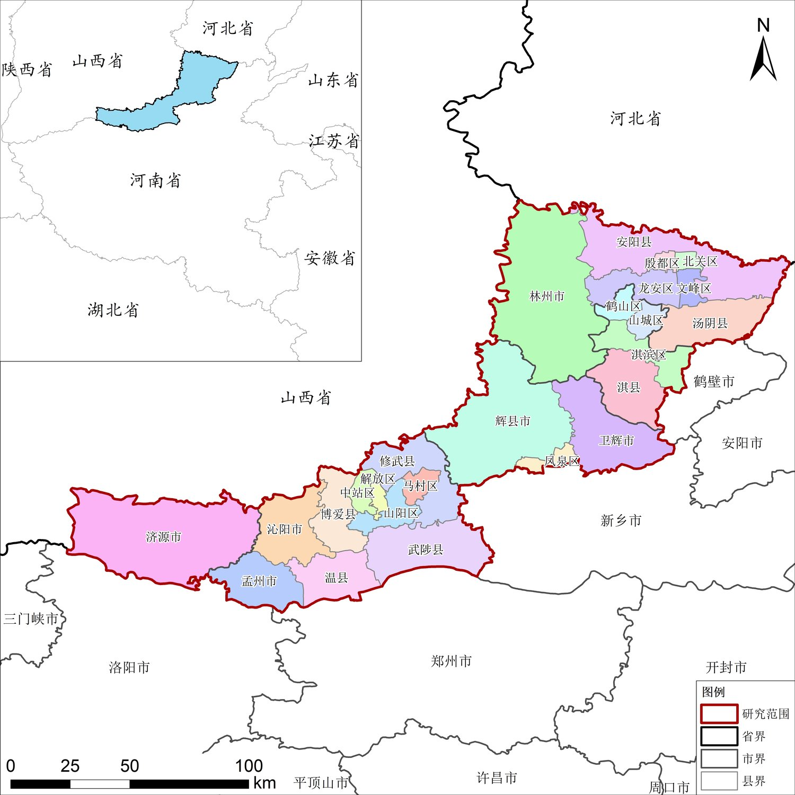
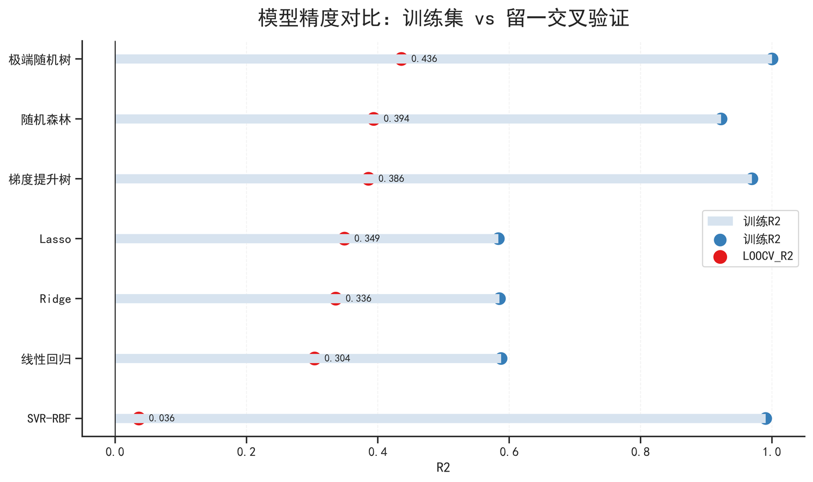

# meme-momo · 地理信息科学 项目代码集

地理信息科学专业。这里收录了我参与的**生态修复评估、国土空间评价、空间统计建模**项目代码，一个用 C# 手写的桌面 GIS 小工具，一个实时地理围栏 LBS 系统，以及日常攒下的 Python 脚本。

代码来自真实项目和竞赛作品，保留原始写法（含中文注释），没有为了好看而重写——这样更能看出当时的思路。

**关于本仓库的代码处理**：所有文件均通过语法检查；个人目录、用户名、账号凭证（Cookie / API 密钥）已全部移除；数据文件因体积与保密要求未入库。详见文末[代码整理与安全处理](#代码整理与安全处理)。

## 项目一览

| # | 项目 | 领域 | 核心方法 / 技术 | 目录 |
|---|---|---|---|---|
| 01 | 南太行生态修复成效评估 | 国土空间生态修复 | ArcPy 空间统计、InVEST 模型（PM2.5 / 土壤保持 / 生境质量） | [`01-nantaihang-restoration`](01-nantaihang-restoration/) |
| 02 | 临汾废弃矿山修复工程 | 矿山生态修复 | ArcPy 矢量处理、斑块（patch）分析、问卷数据可视化 | [`02-linfen-mine-restoration`](02-linfen-mine-restoration/) |
| 03 | 全国油茶种植适宜性评价 | 农业空间适宜性 | 多因子隶属度函数（抛物线型/反S型）、Rasterio 栅格对齐与叠加、重点县提取 | [`03-land-suitability`](03-land-suitability/) |
| 04 | 城市群发展空间异质性建模 | 空间统计 / 计量地理 | MGWR、地理探测器、7 模型 LOOCV 对比、XGBoost + SHAP | [`04-mgwr-shap`](04-mgwr-shap/) |
| 05 | AsiaGIS 桌面 GIS 软件 | GIS 二次开发 | C# WinForms + GDI+，自实现矢量渲染、缩放漫游、要素查询 | [`05-asiagis-desktop`](05-asiagis-desktop/) |
| 06 | ArcGIS Pro 课程实践报告 | 空间分析实践 | ArcGIS Pro 空间分析、专题制图 | [`06-arcgis-coursework`](06-arcgis-coursework/) |
| 07 | Python 实用脚本集 | 效率工具 | requests / BeautifulSoup 爬虫、Pillow 图像批处理、arcpy 字段翻译 | [`07-python-toolbox`](07-python-toolbox/) |
| 08 | 实时地理围栏 LBS 系统 | WebGIS | Node + Express + WebSocket + Turf.js、Vue3 + CesiumJS | [`08-webgis-lbs`](08-webgis-lbs/) |
| 09 | WebGL 图形学实验框架 | 计算机图形学 | 手写 GLSL 着色器、Bresenham 直线算法 | [`09-cg-webgl`](09-cg-webgl/) |

## 一条主线

四个数据类项目其实是一个递进关系：

```
多因子评价（03 油茶适宜性：气候/土壤/地形 → 隶属度 → 综合适宜性）
        ↓ 尺度放大到流域，加入工程实施口径
生态服务核算（01 南太行：三类服务 + 渔网权重体系）
        ↓ 从「算出来」到「算得准、讲得清」
空间统计建模（04 城市群：MGWR 局部系数 + 地理探测器 + 7 模型对照）
        ↓ 工具化，把渲染和交互自己实现一遍
桌面 GIS（05 AsiaGIS：C# 自绘矢量地图）
```

## 成果预览

| 01 · 南太行研究区与治理分区 | 04 · 7 个模型精度对比（LOOCV） |
|---|---|
|  |  |

更多成果图见各项目 README：01 有 6 张专题图（区位、治理分区，以及土地利用 / 生态系统服务 / 碳储量 / 矿山修复的演变组图），04 有 8 张分析图（q 值、交互探测、局部系数热力图、残差、SHAP 系列）。

## 技术栈

| 类别 | 工具 |
|---|---|
| 空间数据处理 | ArcGIS Pro / ArcPy、QGIS、Rasterio、GeoPandas、GDAL |
| 生态评估模型 | InVEST（产水、土壤保持、生境质量、碳储量）、PLUS 土地利用模拟 |
| 统计与建模 | MGWR、地理探测器、scikit-learn、XGBoost、SHAP、Statsmodels |
| 可视化 | Matplotlib（出版级图表，统一字体字号与 dpi）、ArcGIS 制图 |
| 前端 / WebGIS | Vue3、Vite、CesiumJS、WebSocket、Turf.js、Element Plus |
| 图形学 | WebGL、GLSL、Canvas 2D |
| 开发 | Python 3.11+、C# / .NET Framework 4.8、Node.js、Git |

## 目录结构

```
.
├── 01-nantaihang-restoration/
│   ├── scripts/     ArcPy 空间统计脚本（渔网统计、权重计算、矢量分类）
│   ├── weights/     指标权重计算（Notebook）
│   ├── analysis/    InVEST 三类生态系统服务评估（Notebook）
│   └── figures/     成果图 + 出图脚本（批量导出、规范命名、柱状图）
├── 02-linfen-mine-restoration/scripts/
├── 03-land-suitability/scripts/
├── 04-mgwr-shap/{mgwr,shap}/ 含 figures/ 成果图
├── 05-asiagis-desktop/      C# 源码（不含 bin/obj）
├── 06-arcgis-coursework/    实验报告
├── 07-python-toolbox/       Python 小工具（爬虫、图像批处理、文件管理）
├── 08-webgis-lbs/           实时地理围栏系统（Node + Vue3 + Cesium）
└── 09-cg-webgl/             WebGL 图形学实验（含 GLSL 着色器）
```

## 运行说明

**数据不在仓库里。** 遥感影像、矢量数据、项目原始资料体积动辄几百 MB 到几 GB，且部分受项目方保密要求限制，因此各项目 README 只说明数据来源、目录结构与字段，代码运行时需自行放回对应目录或修改脚本顶部的路径变量。

**三套环境**：

```bash
# 1. ArcPy 脚本（01、02、07 的字段翻译）——必须在 ArcGIS Pro 自带 Python 里跑
#    ArcGIS Pro → 分析 → Python 命令提示符，然后 python xxx.py
#    arcpy.CheckOutExtension("Spatial") 需要 Spatial Analyst 许可

# 2. 开源栈（03、04、07 其余脚本）——普通 conda 环境即可
conda create -n gis python=3.11
pip install -r requirements.txt

# 3. Web 项目（08、09）
cd 08-webgis-lbs/server && npm install && npm start   # 后端 :3001
cd 08-webgis-lbs/client && npm install && npm run dev # 前端 :5173
cd 09-cg-webgl && python -m http.server 8000          # 静态服务
```

**路径要改。** 原始脚本写的是本机绝对路径，整理时已统一改为相对路径（如 `r"dasai\南太行数据"`），运行前把数据放到对应目录、或修改文件顶部的 `base_dir` / `*_PATH` 变量即可。

## 代码整理与安全处理

这个仓库是作品集，不是原始备份，整理时做了以下处理并逐条核对：

| 处理项 | 说明 | 数量 |
|---|---|---|
| 语法检查 | 全部 `.py` 用 `py_compile` + `pyflakes`，`.ipynb` 逐单元格编译，`.js` 用 `node --check` | 57 个文件全部通过 |
| 移除账号凭证 | B 站 Cookie（含 SESSDATA）、百度翻译 APPID 与 secretKey 已替换为占位符 | 2 处 |
| 移除个人路径 | `C:\Users\...`、盘符绝对路径统一改为相对路径 | 130+ 处 |
| 移除学号 | 文件名与内容中的学号已删除 | 全部 |
| 剔除无关文件 | 软件安装残留、第三方库、`.conda` 环境、`bin/obj`、`node_modules`、课程提供的教程文档 | — |
| 修复无法运行的代码 | 1 个脚本是两段代码交叉粘贴导致残缺，按功能拆分并修复 | 1 处 |

**没有做的事（如实说明）**：

- 未在所有环境实际运行。ArcPy 脚本需要 ArcGIS Pro 许可，本机无法验证；其余项目因数据未入库，也缺少运行所需的输入文件
- 未做代码风格统一（PEP8、命名重构），保留原始写法便于对照当时思路
- `.vue` 组件未做静态语法检查（需 Vite 编译才能验证）

## 关于代码质量

- 部分脚本是为一次性分析任务写的（变量命名简短、逻辑集中在一个文件里），保留原样，未做工程化重构
- 项目 04 是方法最完整的一个：模型选择、交叉验证、显著性检验完整链路，可直接复用
- 项目 05 的 2484 行 C# 全部自写渲染，不含第三方 GIS 库
- 项目 08 是唯一的全栈 Web 项目，前后端分离 + 实时通信跑通

## 联系

- Gitee：[@sang-yehao](https://gitee.com/sang-yehao)
- 论文写作仓库：[paper](https://gitee.com/sang-yehao/paper)

## License

[MIT](LICENSE) —— 代码可自由参考，但请勿直接用于课程作业提交。
